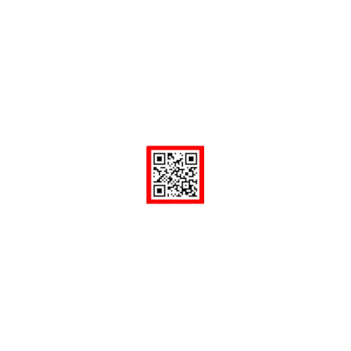

<div align="center">

# 🤖 Prácticas de Robótica

**Odometría con un Roomba, simulador de odometría, brazo robótico de 6 grados de libertad y visión artificial con OpenCV**

[]()
[]()
[]()
[]()
[]()

[Descripción](#-sobre-el-proyecto) · [Roomba](#-1--roomba-odometría-con-un-robot-real) · [Odometría](#-2--simulador-de-odometría) · [Manipuladores](#-3--brazo-robótico-de-6-gdl) · [Visión](#-4--visión-artificial-con-opencv) · [Estructura](#-estructura-del-repositorio) · [Stack](#-stack-tecnológico)

</div>

---

## 📖 Sobre el proyecto

Cuatro prácticas de *Robótica* que cubren la cadena completa de un robot: **saber dónde está** (odometría), **moverse** (cinemática de un brazo) y **ver el entorno** (visión por computador).

> 📌 **Proyectos académicos** de la asignatura de *Robótica* (4.º curso, Universidad de Salamanca). La práctica del Roomba se hizo en el **grupo 2**, junto a Jorge Caballero González, Mireya Fernández Gallego y Alejandro Sánchez Sánchez; el resto, con Jorge Caballero González.

---

## 🧹 1 · Roomba: odometría con un robot real

[`roomba/trabajoFinalRoomba.py`](roomba/trabajoFinalRoomba.py)

Un **Roomba 600 de iRobot** conectado al ordenador por puerto serie y controlado **desde el teclado**, mediante la librería `pycreate2`. El programa lee los **encoders de las ruedas** y, con las fórmulas vistas en clase, calcula la distancia recorrida por cada rueda, el **ángulo de orientación** y la **posición (x, y)** respecto al punto de partida, que va mostrando en pantalla.

> ⚠️ Usa `tty`/`termios` y el puerto `/dev/ttyUSB0`, por lo que está pensado para **Linux** y necesita el robot conectado.

---

## 🧭 2 · Simulador de odometría

[`odometry/odometria.py`](odometry/odometria.py)

Una simulación en **Pygame** que reproduce la odometría sin necesidad del robot: un mapa de coordenadas con ejes, el robot en el origen con una **flecha de orientación**, el **recorrido marcado en rojo** y la odometría (orientación, x, y) actualizada en pantalla.

- Al arrancar, permite **usar los valores por defecto** o **configurar** la separación entre ruedas, el radio de cada rueda y la resolución del encoder.
- Se maneja con el teclado: `i`/`k` avanzar y retroceder, `l`/`j` rotar y `o`/`u` girar.
- Con él se comprobó el efecto de **ruedas de distinto diámetro**: el robot siempre tiende hacia el lado de la rueda más pequeña, y aumentar la separación entre ruedas reduce el desvío pero no es una solución práctica.

---

## 🦾 3 · Brazo robótico de 6 GDL

[`manipulators/`](manipulators)

Un **manipulador de 6 grados de libertad** construido en **CoppeliaSim** (`.ttt`) y un script de **MATLAB** (`.m`) que calcula su posición final a partir de los ángulos de las articulaciones, con los **parámetros de Denavit-Hartenberg**:

| Articulación | d (m) | a (m) | α (°) |
| :---: | :---: | :---: | :---: |
| 1 | 0,35 | 0 | 90 |
| 2 | 0 | 0,30 | 0 |
| 3 | 0 | 0,30 | 90 |
| 4 | −0,20 | 0 | 90 |
| 5 | 0 | 0,30 | 90 |
| 6 | 0 | 0,30 | 0 |

Ejemplo del script: con `Q = [45 35 -15 25 45 -70]` (grados) calcula hacia dónde apunta el extremo del brazo.

---

## 👁️ 4 · Visión artificial con OpenCV

[`computer-vision-qr/VisionQR.py`](computer-vision-qr/VisionQR.py)

Un robot que recorre un entorno de oficinas con una cámara y debe **encontrar y leer códigos BIDI incrustados en un cuadrado rojo**, y ajustar su posición respecto a ellos. Con OpenCV detecta el contorno del código y calcula:

- el **desplazamiento horizontal y vertical** del centro de la cámara respecto al del código,
- si el **tamaño** del código en la imagen es aceptable y, si no, la orden para corregirlo (acercarse o alejarse).

Las imágenes de prueba están en [`images/`](computer-vision-qr/images). Se simula el movimiento del robot con las teclas `w`, `a`, `s`, `d`, `e` y `r`, que cambian de imagen, y se sale con `q`.

<p align="center">
  
  
  
</p>

<p align="center"><em>El mismo código a distintas distancias: es lo que el robot tiene que interpretar para decidir su siguiente movimiento.</em></p>

---

## 🚀 Cómo ejecutarlo

```bash
# Simulador de odometría
pip install pygame
python odometry/odometria.py

# Visión artificial
pip install opencv-python numpy
python computer-vision-qr/VisionQR.py

# Roomba (necesita el robot conectado)
pip install pycreate2 pyserial
python roomba/trabajoFinalRoomba.py
```

El brazo requiere **CoppeliaSim** (abrir `manipulators/Tarea_manipuladores.ttt`) y **MATLAB** (ejecutar `Tarea_manipuladores.m`).

---

## 📂 Estructura del repositorio

```
Robotics-Practices/
├── roomba/                  trabajoFinalRoomba.py
├── odometry/                odometria.py
├── manipulators/            Tarea_manipuladores.m · Tarea_manipuladores.ttt
└── computer-vision-qr/      VisionQR.py · images/
```

---

## 🖥️ Stack tecnológico

| Categoría | Herramientas |
| :--- | :--- |
| **Lenguajes** | Python · MATLAB |
| **Robótica** | Odometría · cinemática directa (Denavit-Hartenberg) · CoppeliaSim · iRobot Create 2 |
| **Visión** | OpenCV · NumPy · detección de contornos |
| **Simulación** | Pygame |

---

## 🎓 Qué aprendí

- Que **un pequeño error en el diámetro de una rueda se acumula** y desvía todo el recorrido.
- A **describir un brazo con parámetros D-H** y comprobarlo en un simulador.
- A **pasar de píxeles a órdenes de movimiento** con visión artificial.

---

## 📝 Notas

Las memorias de las prácticas no se incluyen porque contienen datos personales del grupo.

---

## 👤 Autoría

**Unai García** — con **Jorge Caballero González** (y, en la práctica del Roomba, **Mireya Fernández Gallego** y **Alejandro Sánchez Sánchez**)

Grado en Ingeniería Informática (Universidad de Salamanca)

- 🐙 GitHub: [@unaigb](https://github.com/unaigb)

---

<div align="center">

**⭐ Si este repositorio te resulta útil, considera darle una estrella.**

</div>
